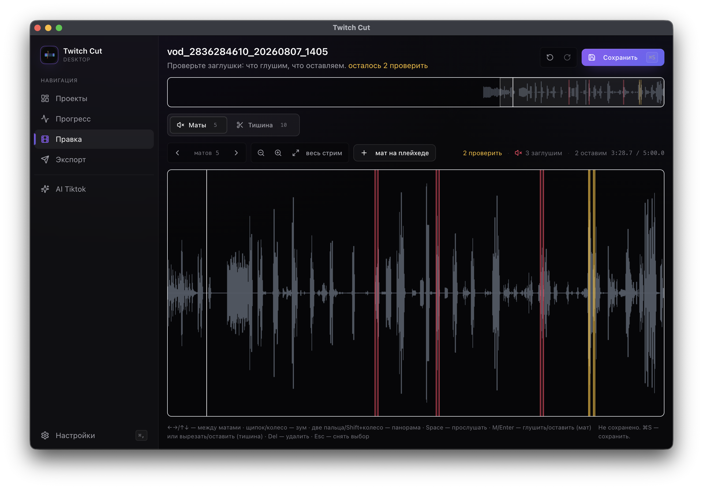
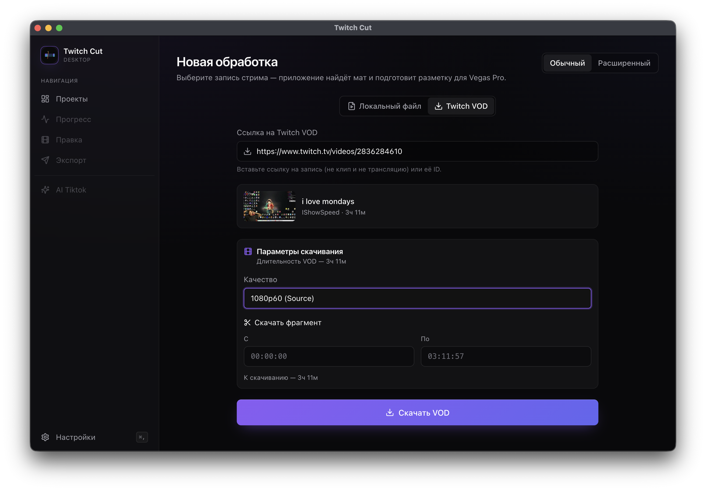
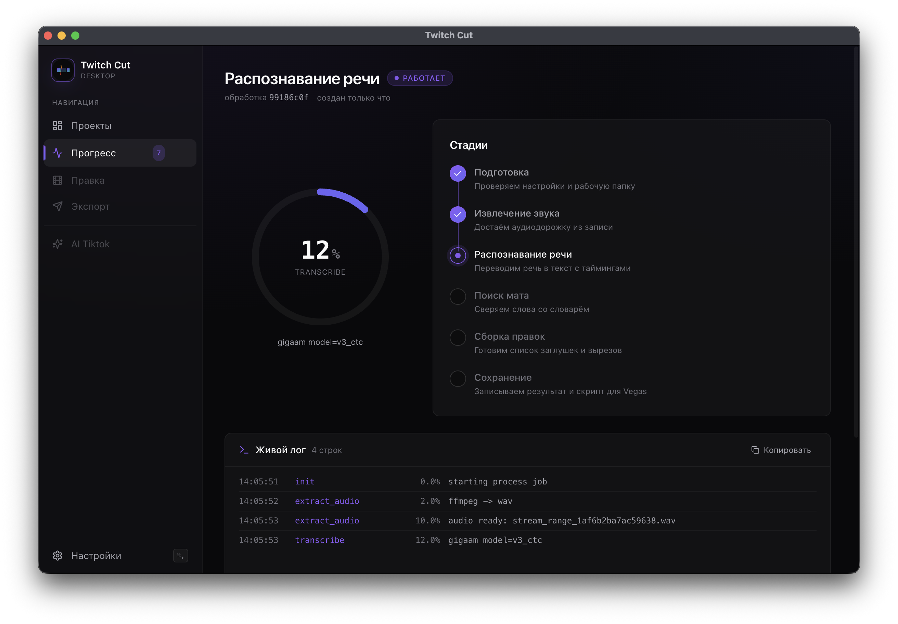
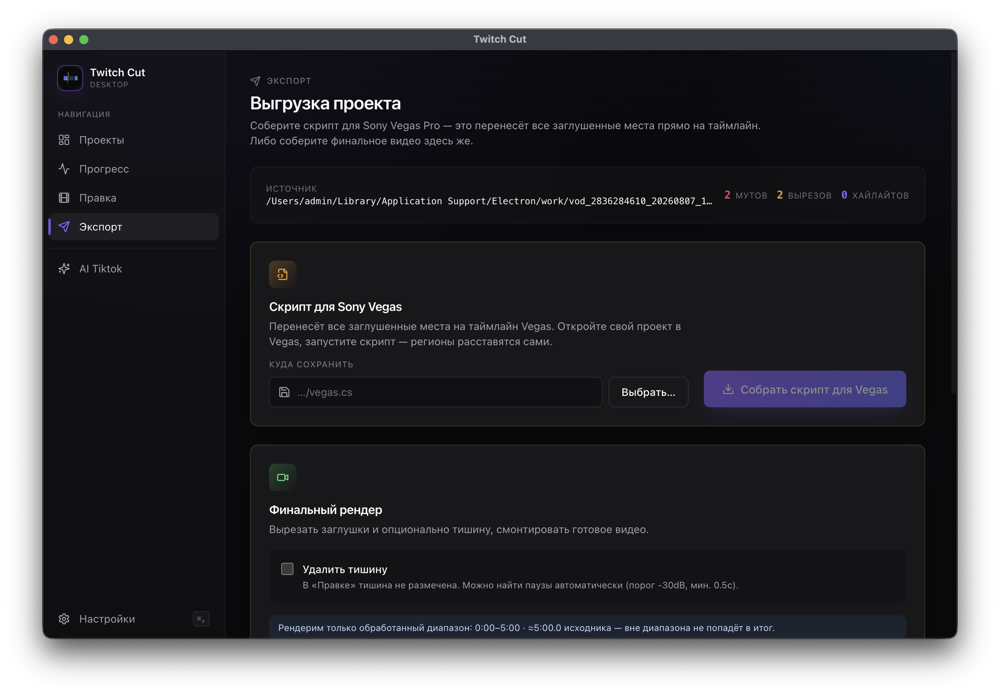
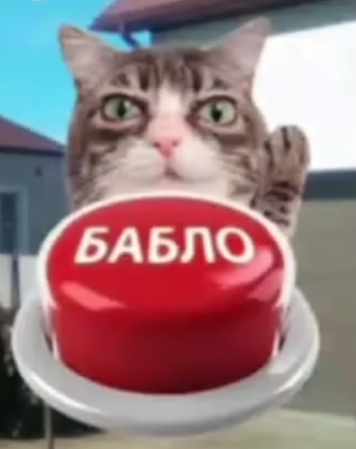

# Twitch Cut

**Авто-цензурирование матов из видео для YouTube (RU)**

## Что это
Программа автоматически цензурирует (приглушает) маты из видео, а вы проверяете и выгружаете проект в Vegas Pro для дальнейшего монтажа или рендерите в `.mp4`.

Что умеет программа:
- **Находить мат** - распознаёт русскую речь и приглушает нецензурные слова.
- **Убирать тишину** - находит тишину и вырезает.
- **Генерировать Shorts-контент** - анализирует видео через NotebookLM и находит релевантные моменты.

## Установка

### Windows

1. Скачайте [**последнюю версию**](https://github.com/arm4tura/twitch/releases) (`Twitch Cut Setup.exe`).
2. Запустите установщик.
3. Откройте **Twitch Cut** из меню «Пуск».

### macOS

1. Скачайте `.dmg` из [**релизов**](https://github.com/arm4tura/twitch/releases): `arm64` — для Apple Silicon (M1/M2/M3…), `x64` — для Intel-маков.
2. Откройте образ и перетащите **Twitch Cut** в «Программы».
3. Первый запуск: правый клик по иконке → **«Открыть»** → **«Открыть»** ещё раз. Это нужно один раз, потому что сборка пока не подписана Apple-сертификатом (macOS иначе блокирует «приложение от неустановленного разработчика»).

При первом запуске программа сама скачает всё необходимое. Установка занимает ~10-15 минут, дальше программа запускается сразу.

> **Требования:** Windows 10/11 или macOS 12+ и ~10 ГБ на диске. Видеокарта NVIDIA - не обязательна, но с ней программа будет работать быстрее (только Windows; на macOS распознавание идёт на CPU).

## Как пользоваться

| | |
|---|---|
| **1. Новый проект** | Выберите запись стрима и словарь мата. |
| **2. Обработка** | Нажмите «Запустить» и подождите - программа сама всё разметит. |
| **3. Проверка** | Послушайте заглушки, поправьте где нужно (`Space` - прослушать, `M` - глушить/оставить, `Del` - убрать). |
| **4. Экспорт** | Откройте Vegas Pro 21 -> Scripting -> Run Script и выберите `.cs`, которую создала программа. |

## Документация

- [Установка и первый запуск](./docs/getting-started.md)
- [Как это работает внутри](./docs/how-it-works.md)
- [Запуск из исходников и сборка](./docs/development.md)
- [Настройки распознавания и словарь мата](./docs/configuration.md)

## Лицензия

MIT - см. [`LICENSE`](./LICENSE).

## Поддержать

Если программа сэкономила вам время на монтаже:

